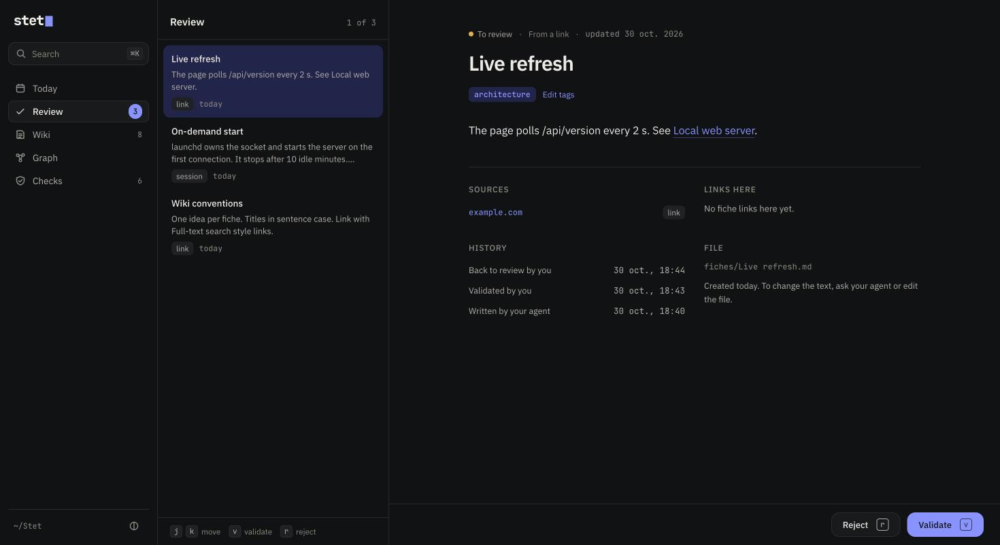
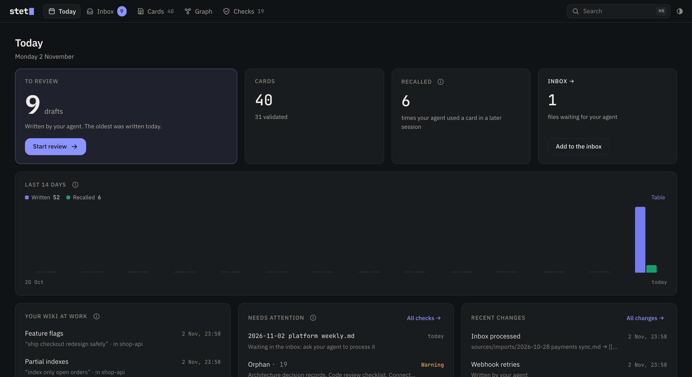
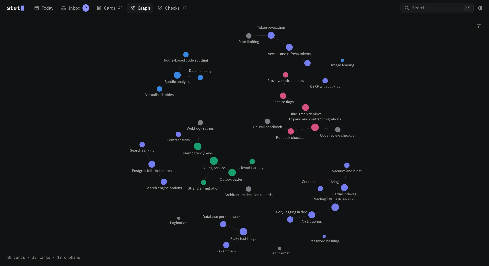

# stet

Keep what you learn while you work with a coding agent, in a markdown wiki the agent writes and maintains for you.

You already decide things, fix problems and read sources in your Claude Code sessions. Most of it is lost when the session ends. With Stet, the agent writes it down as linked markdown cards, during the session, when you type `/stet` or say "keep this". Stet itself has no model: it checks every write, keeps the index and the log, and gives you an interface to read and validate what the agent wrote.

```sh
npm install -g @carret/stet && stet connect
```

New here? Read the [user guide](docs/guide.md).

`stet connect` creates the wiki in `~/Stet`, registers the MCP server with Claude Code and installs a skill and a session hook. It takes under a minute. Requires Node 22.12 or later and macOS for the on-demand start.



| Figure | Meaning |
| --- | --- |
| **130 ms** | to start the MCP server and answer a first call, measured 5 times |
| **13 ms** | to search 1,000 cards |
| **16 ms** | to check 1,000 cards for broken links, missing sources, orphans and duplicates |
| **0.31 s** | to open the interface from the Dock when the server is stopped, then 0.02 s |

Measured on an Apple M3 with 8 GB of memory, Node 22.14. Reproduce with `node scripts/bench.mjs`.

## How it works

The idea comes from Andrej Karpathy's [LLM Wiki](https://gist.github.com/karpathy/442a6bf555914893e9891c11519de94f): instead of retrieving fragments for every question, an LLM compiles sources once into a wiki of linked markdown files and keeps it current.

```
~/Stet/
  inbox/              files you drop in
  sources/            immutable once processed
    imports/          originals from the inbox
    sessions/         session notes written by the agent
  cards/             the wiki, linked with [[Title]]
  index.md            generated by Stet
  log.md              generated by Stet
  AGENTS.md           the rules the agent follows
  .stet/              config, usage, rejected cards
```

The agent writes through the MCP server, never with its file tools. Your editor (Obsidian, VS Code) can open the folder at any time: file names match titles, so `[[links]]` resolve in Obsidian too.

## Capture during your work

In any project, when a session produces a decision, a fix or a fact, the agent proposes once to keep it. Type `/stet` (or `/stet` followed by what to keep), or say "keep this", and it:

1. writes a session note in `sources/sessions/`: what was established and how, with file paths, commits, URLs;
2. searches the wiki and updates an existing card, or creates one;
3. cites the session note as the source.

Every new or changed card is a draft until you validate it in the interface.

| You say | The agent does |
| --- | --- |
| `/stet`, or "Keep this in Stet." | `write_session_note`, `search`, `write_card` |
| "Process the Stet inbox." | `queue_next`, `write_card` citing `inbox/<file>`, `complete_item`, until the inbox is empty |
| "What did we decide about billing?" | `search`, `read`, answers citing card titles |
| "Check the wiki." | `lint`, fixes what it can, reports the rest |

## Every write is checked

The server refuses a card, and tells the agent why, when:

- it has no source, or a local source that does not exist;
- a source is outside `sources/` or `inbox/` and is not a URL, or is another card;
- it has no tag;
- it links to a card that does not exist;
- its title is taken, or differs from an existing one only by case, accents or punctuation;
- it is written from a folder listed in `excluded` in `.stet/config.toml`.

The agent always writes drafts. Only you validate, and a validated card goes back to draft when the agent changes it. Session notes are read-only once written.

```yaml
---
title: Billing service uses PostgreSQL
status: draft
sources:
  - sources/sessions/2026-10-30-billing-database.md
tags: [billing, architecture]
created: 2026-10-30
updated: 2026-10-30
---
Billing needs concurrent writes from several workers, so it uses PostgreSQL. See [[Billing service]].
```

## The interface

`stet open` opens it in your browser. To keep it in the Dock: Safari › File › Add to Dock, or Chrome › Install.

- **Today**: drafts waiting, writes and recalls over 14 days, *Your wiki at work* (which card your agent pulled in, in which project, for what question), what needs attention, recent changes.
- **Inbox**: everything new. *For you*: the drafts your agent wrote; `↑` `↓` (or `j` `k`) move, `v` validates and opens the next one, `r` rejects, `e` edits. A card you had validated and the agent changed since opens on what changed. *For your agent*: files you added (meeting notes, a transcript, an article, a link) with *Add* or by dropping them on the window; your agent turns them into drafts at the start of your next session, with no command to type. A processed file leaves the inbox and stays as the source of its cards.
- **Cards**: every card, grouped by project like folders you never have to fill, filtered by words, status, project, kind or topic, in the same reader. Each card has a **kind** (decision, fix, fact, how-to, reference), a **project** (from a list you can extend) and free **topics**: your agent fills them when it writes the card; you change them in one click. A card opens read-only; *Edit* (`e`) switches to its markdown, `⌘S` saves. Links are checked as for the agent, and the status stays.
- **Graph**: cards as dots, links as lines. Hover or click a card to highlight its neighbours; labels appear as you zoom in. Options: colour by project, kind or topic, show only orphans and separate groups.
- **Checks**: problems grouped by kind, rejected cards (with Restore) and the log on the left; the card on the right, in the same reader.
- **⌘K** or `/` searches cards and jumps to any screen.
- **← →** move between the tabs.





The interface changes status and tags only. The text stays with the agent or your editor.

The server listens on 127.0.0.1 only and checks the `Host` and `Origin` headers, so another website open in your browser cannot read or change the wiki. Fonts are bundled. Stet makes no network request.

## On-demand start

`stet connect` offers to register a launchd agent. launchd holds the port and starts the server when the interface opens; the server stops after 10 idle minutes. Nothing runs in the background otherwise. Without it, `stet open` starts the server.

## Commands

| Command | What it does |
| --- | --- |
| `stet init [path]` | Create the wiki (default `~/Stet`) |
| `stet connect` | Register the MCP server, install the adapter, offer the on-demand start |
| `stet connect --no-adapter` | MCP server only |
| `stet disconnect [--adapter-only]` | Undo `connect`; the wiki stays |
| `stet open` | Open the interface |
| `stet status` | Cards, drafts, inbox, checks, recalls |
| `stet lint [--fix] [--json]` | Run the checks; `--fix` rebuilds the index |
| `stet serve` | Run the interface in the foreground |
| `stet mcp` | The MCP server; Claude Code starts it |

## Configuration

`~/Stet/.stet/config.toml`:

```toml
port = 4747
excluded = ["~/Work/client-repos"]   # no capture, writes refused
inbox_stale_days = 7
draft_stale_days = 14
idle_minutes = 10
```

`STET_HOME` points Stet at another wiki.

## Agents

Tested with Claude Code. The core is an MCP server with instructions and an `AGENTS.md` file; the Claude Code adapter (a skill and a `SessionStart` hook) only adds reminders. The technical test runs the same scenario with a real `claude -p`, with and without the adapter (`node scripts/technical-test.mjs`):

| Step | With adapter | Without adapter |
| --- | --- | --- |
| "Keep this": session note and card | pass, 14.0 s | pass, 13.2 s |
| "Process the inbox": card from the import, inbox empty | pass, 48.9 s | pass, 31.1 s |
| New session asks about it: answer from the card, reuse counted | pass, 9.2 s | pass, 8.1 s | Other MCP clients should work with `stet mcp` but are not tested yet.

## What Stet does not do

No model, no embeddings, no account, no sync: share the folder with git or a synced drive if you need to. No editor: write in your own. The inbox accepts text formats only (`.md`, `.txt`, `.vtt`, `.srt`); convert PDFs and web pages first, or ask the agent to. Contradictions and outdated facts are for the agent to find when you ask for a deep check; Stet checks only what code can check.

## Development

```sh
npm install
npm run build      # server and interface
npm test           # 47 tests: format, vault, MCP over stdio, web API, adapter
npm run dev:ui     # interface with hot reload, against `stet serve`
npm run first-run  # the interface as a new user sees it: empty wiki, fresh browser profile
```

MIT licence.
